# T-Display-S3 desk dashboard

A Wi-Fi desk dashboard for the **LilyGO T-Display-S3** (ESP32-S3, 1.9" 320×170 screen), written in **CircuitPython 10**. It rotates through weather, your Zerodha portfolio, market indices, live cricket and top news, and turns into a dim analog clock at night.

| | |
|---|---|
| 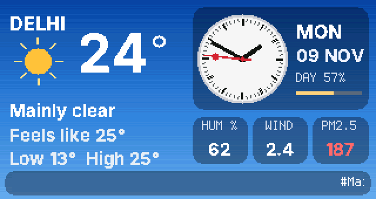 | 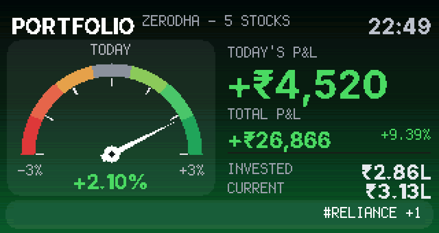 |
| 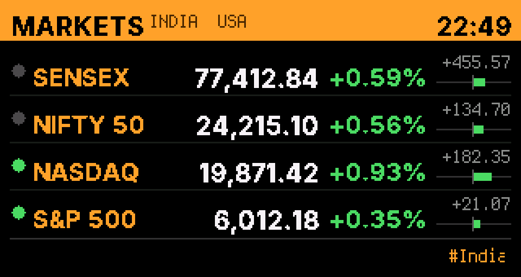 | 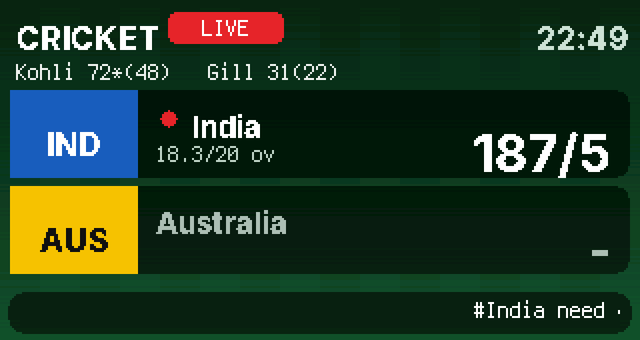 |
| 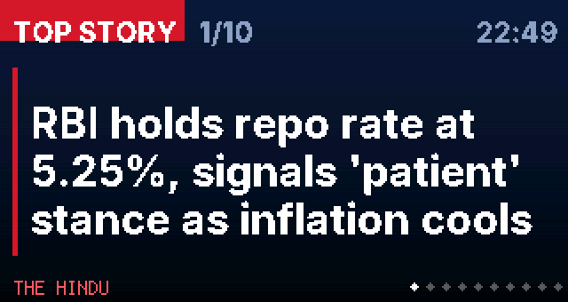 | 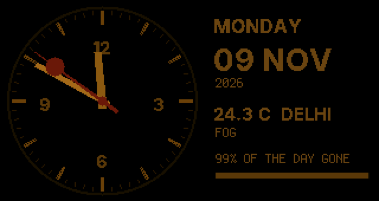 |

*(The default **aura** look. Previews are from the desktop simulator with sample data. The original grey look is still available as [`THEME = "classic"`](#looks-themes).)*

## Screens

| Screen | What it shows | Data source |
|---|---|---|
| **Weather** | Temperature, feels-like, low/high, humidity, wind, PM2.5, and an analog clock with smooth hands, the date and how much of the day has gone | [Open-Meteo](https://open-meteo.com) forecast + air quality (no key) |
| **Portfolio** | Today's P&L and total P&L, invested and current value, stock count, and a ticker of the biggest movers | [Kite Connect](https://kite.trade) Personal API (free) |
| **Markets** | SENSEX, NIFTY 50, NASDAQ, S&P 500 with change and open/closed state | Yahoo Finance chart feed (India), [FMP](https://financialmodelingprep.com) free API (US) |
| **Cricket** | Live score for a match you pick: teams, score, overs, current batters | ESPNcricinfo live-scores RSS (every 30 s) + match details |
| **News** | Top 10 India headlines, one at a time in large text, with source and a progress bar | Google News India RSS (falls back to The Hindu, then Times of India) |
| **Holdings heatmap** | A tile per stock, sized by value, coloured by today's move | Kite holdings |
| **Stat of the day** | A player's international numbers this year plus career line; a cricket fact when offline | ESPNcricinfo Statsguru |
| **Trivia** | A multiple-choice question; the answer lights up after 30 s | [Open Trivia DB](https://opentdb.com) (built-in questions offline) |
| **Internet** | Ping graph, router ping, Wi-Fi signal, board speed test, router uptime, outage log | Ping, Cloudflare speed test, router UPnP |
| **Pet** | Moong, a sprout creature whose mood follows today's P&L; feed it with BOOT | Kite + NVM |
| **Night clock** | Large dim analog clock, date, temperature (23:00–07:00 by default) | — |
| **Night screensavers** | Matrix rain, fire or a starfield instead of the clock (`NIGHT_SCREEN`) | — |

## Looks (themes)

`THEME` in `settings.toml` picks the look; the board's web page (`/theme`) can switch it too, without editing files.

### `aura` (default)

Each screen borrows a different, well-known visual language, so you can tell them apart from across the room:

| Screen | Idea | Details |
|---|---|---|
| Weather | **Living sky**, after weather apps like CARROT where the background *is* the forecast | The gradient follows time of day (dawn, day, dusk, night) and conditions (cloud, fog, rain, storm, snow). Frosted-glass cards, a drawn weather symbol, and a Swiss station clock. PM2.5 is coloured by air-quality band. |
| Portfolio | **Mood dial** | A red-to-green dial (a preview of the servo P&L gauge project) whose needle eases to today's % move; the whole backdrop glows green or red with the day. |
| Markets | **Trading terminal**, after the Bloomberg Terminal's amber-on-black | One row per index: open/closed dot, value, % change, absolute change and a centred change bar (full bar = 2 %). |
| Cricket | **Broadcast scorebug** | Team-colour blocks (countries and IPL sides), a big score, a red dot for the batting side and a LIVE pill, on a mown-pitch backdrop. |
| News | **TV lower third** | Red TOP STORY tag, big white headline with a red rule, source and progress dots. |
| Clock | **Station clock** | White Swiss-railway face with the red "lollipop" seconds hand by day; dim warm amber at night so the room isn't lit blue. |

| | |
|---|---|
| 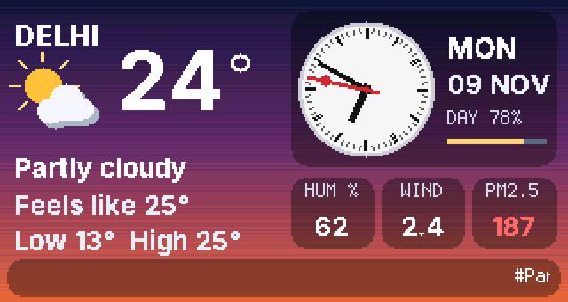 | 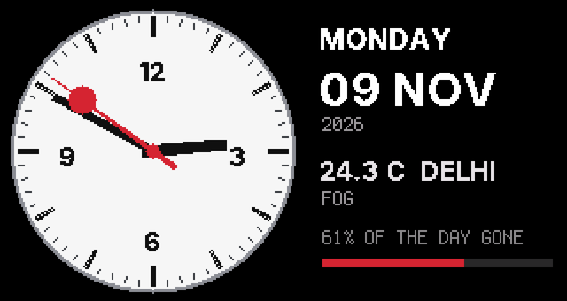 |

### `classic`

The original grey look:

| | |
|---|---|
| 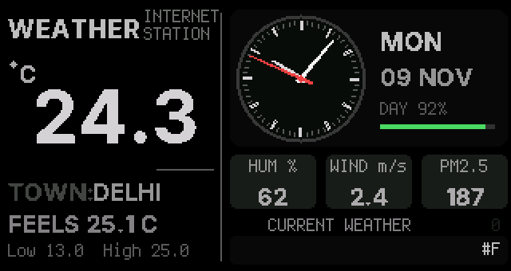 | 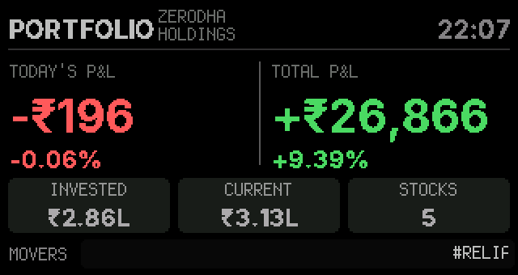 |
| 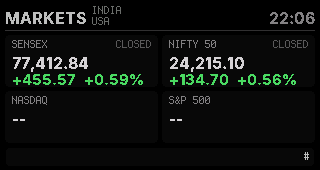 | 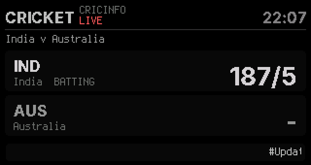 |
| 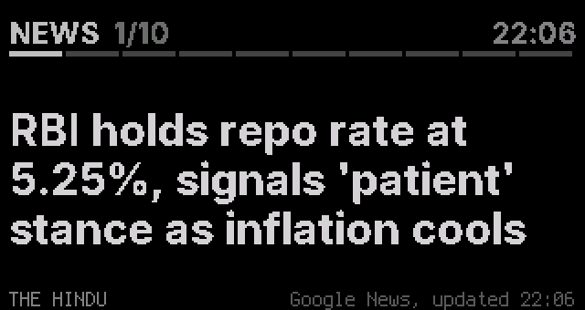 | 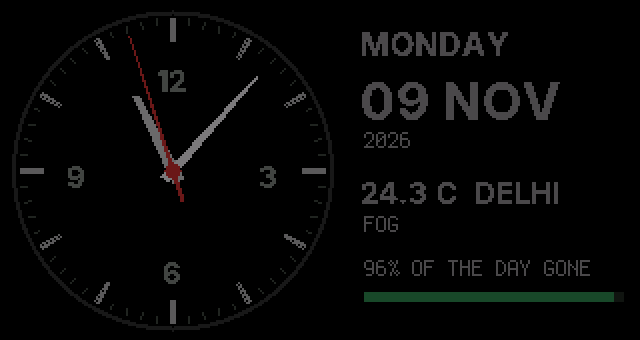 |

## More screens

| | |
|---|---|
| 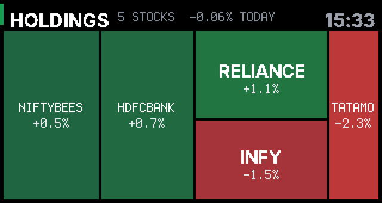 | 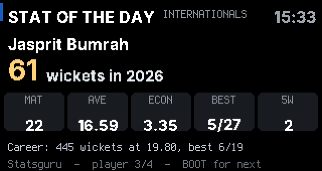 |
| 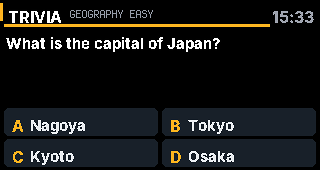 | 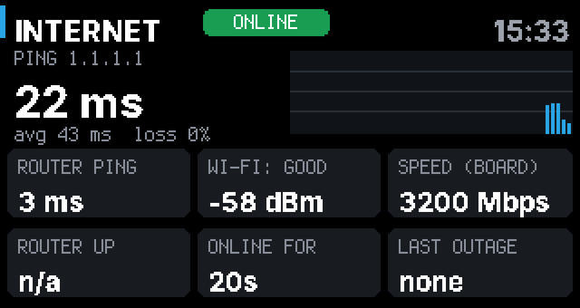 |
| 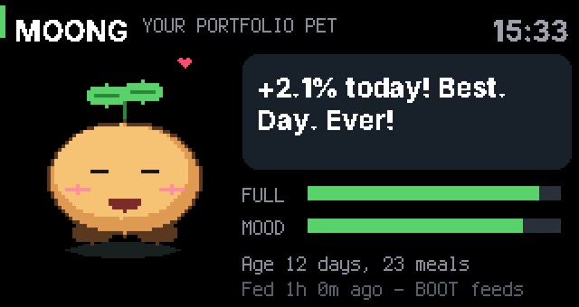 | 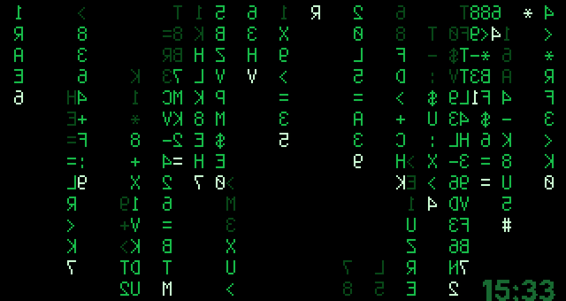 |
| 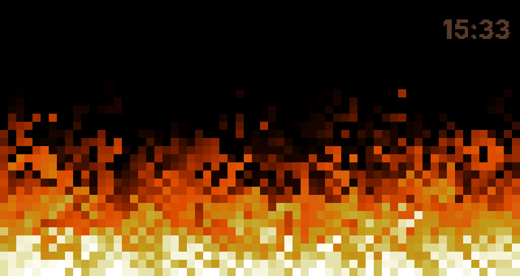 |  |

- **Holdings heatmap:** a squarified treemap of your Kite holdings (up to 16 tiles; the rest fold into "+N MORE"). Skipped in the rotation until you log in.
- **Stat of the day:** one player per day from `STAT_PLAYERS` (Cricinfo player ids). Shows this year's runs or wickets, five key numbers and the career line, refreshed every 6 hours. If Statsguru can't be read it shows a cricket fact instead; `/stat/debug` on the board's web page shows what it got.
- **Trivia:** questions from Open Trivia DB (no key needed), 15 at a time without repeats. The bar counts down, then the right answer turns green for 8 seconds. The screen stays up for the whole question when auto-rotating.
- **Internet:** pings `PING_HOST` (1.1.1.1) every 5 s while showing (every minute otherwise) and the router, Wi-Fi signal strength, a 400 KB download speed test every 30 minutes (this measures the board's own speed, which is far below your line's), the router's uptime if it answers UPnP (many do; otherwise "n/a"), and the last outage.
- **Pet:** Moong's leaf and face follow today's P&L (thrilled above +1.5%, worried below −1.5%), it gets hungry after 8 hours without food, and it sleeps at night. Its birthday, last meal and meal count survive restarts. Feed it with BOOT or at `/pet`.
- **Screensavers:** set `NIGHT_SCREEN` to `matrix`, `fire`, `stars` or `cycle` (a different one each hour). They can also go in `SCREEN_ORDER`.

## Buttons

- **KEY** (GPIO14): next screen. At night it wakes the other screens for 60 seconds.
- **BOOT** (GPIO0) does something on some screens: next headline (News), reveal the answer, then next question (Trivia), next player (Stat), feed (Pet), run a speed test now (Internet).

## Install

1. Flash **CircuitPython 10.x** for the LilyGO T-Display-S3 (from [circuitpython.org](https://circuitpython.org/board/lilygo_tdisplay_s3/)).
2. Copy `code.py`, `fonts/` and `lib/` from this folder to the `CIRCUITPY` drive (or upload them through the web workflow at `http://<board-ip>/code/`).
3. Copy `settings.toml.example` to the board as `settings.toml` and fill in your Wi-Fi, town and API keys.
4. The board restarts and the screens appear. Its IP address is printed on the serial console.

## Board web page (port 8080)

Open `http://<board-ip>:8080` on a phone or laptop on the same Wi-Fi:

| Page | Use |
|---|---|
| `/` | Kite login link, paste-the-redirect-URL form, auto-rotate toggle |
| `/kite` | Where the Kite login lands (via the https redirect page) |
| `/cricket` | Pick which live match to follow, or turn cricket off |
| `/cricket/debug` | Raw details of the cricket feed, for troubleshooting |
| `/rotate?on=0` / `?on=1` | Turn auto-rotate off / on |
| `/pet` | See when the pet last ate and feed it from your phone |
| `/stat/debug` | What the Stat of the day screen got from Statsguru |
| `/theme` | Switch between **aura** and **classic** (saved on the board, restarts it); "Use settings.toml" goes back to the `THEME` setting |

### Daily Kite login

Kite access tokens expire every morning (around 07:30 IST). Kite only accepts an **https** redirect URL, so the login goes through a tiny GitHub Pages page ([kite-redirect](https://github.com/agarwalsarthak121/kite-redirect)) that forwards the `request_token` to the board:

1. In your Kite developer app, set the redirect URL to the GitHub Pages URL.
2. Each morning open `http://<board-ip>:8080`, tap **Login with Kite**, and sign in.
3. If the forward fails, copy the URL you land on and paste it into the form on the board's page.

## Settings

Everything is configured in `settings.toml`; see [`settings.toml.example`](settings.toml.example) for every key and its default. The most useful ones:

| Key | Default | Meaning |
|---|---|---|
| `THEME` | `aura` | `aura` (a different style per screen) or `classic` (the original grey look) |
| `SCREEN_ORDER` | `weather,portfolio,heatmap,markets,cricket,stat,news,trivia,net,pet` | Which screens rotate, in order (also available: `clock`, `matrix`, `fire`, `stars`) |
| `NIGHT_SCREEN` | `clock` | What shows at night: `clock`, `matrix`, `fire`, `stars` or `cycle` |
| `STAT_PLAYERS` | Kohli, Rohit, Bumrah, Gill | `id:Name` or `id:Name:bowl`, comma separated (the id is in the player's Cricinfo URL) |
| `STAT_CLASS` | `11` | `11` all internationals, `1` Tests, `2` ODIs, `3` T20Is |
| `TRIVIA_SECONDS` / `TRIVIA_CATEGORY` | `30` / any | Time to think; optional Open Trivia DB category id (9 general, 17 science, 21 sports, 22 geography, 23 history) |
| `PET_NAME` / `PING_HOST` | `Moong` / `1.1.1.1` | Pet's name; what the Internet screen pings |
| `SCREEN_SECONDS` | `15` | Seconds per screen |
| `AUTO_ROTATE` | on | `off` = change screens only with the KEY button |
| `NEWS_SECONDS` / `NEWS_PER_VISIT` | `6` / `10` | Seconds per headline / headlines per visit |
| `NIGHT_HOURS` | `23-7` | Night clock hours (`""` turns it off) |
| `DAY_BRIGHTNESS` / `NIGHT_BRIGHTNESS` | `0.6` / `0.05` | Backlight levels |
| `WATCHDOG` | on | `off` disables the 2-minute hang watchdog (handy while debugging) |

## How it works

- One main loop does everything: fetches data on timers, serves the web page, reads the buttons, and animates the clock hands and tickers. Nothing may block for long, so network calls have short timeouts and finished sockets are freed straight away.
- `adafruit_httpserver` is patched in `code.py` so a browser's empty "preconnect" socket can't freeze the board (the stock library loops forever on a 0-byte read).
- Fonts are Inter, converted to bitmap PCF fonts with [`tools/mkfont.py`](../tools/mkfont.py).
- The aura backgrounds are one 320×170 bitmap per screen with a 32-colour palette (16 gradient shades plus 16 darker "glass" shades for the cards), ordered-dithered so there's no banding. Changing the sky or the P&L mood only rewrites the palette, which is instant.
- Refresh rates are tuned to the free API limits: weather every 10 min, Kite every 5 s on screen in market hours, cricket every 30 s, Indian indices every 60 s on screen, US indices every 12 min (FMP allows 250 calls a day), news every 15 min.

## Outages and power cuts

The dashboard is built to look after itself:

| What happens | What the board does |
|---|---|
| **Power cut** (the board boots before the router) | Shows "Waiting for Wi-Fi" and keeps retrying, then starts normally. |
| **Wi-Fi drops** (router restart) | Shows a red **NO WI-FI** badge and reconnects (after 10 s, 20 s, 40 s, then every minute). If the router hands out a new IP, the web page moves to it. After 20 minutes without Wi-Fi it restarts itself in case the Wi-Fi chip is stuck. |
| **Internet down, Wi-Fi fine** | After two failed requests it checks a tiny Google test page. If that fails too, it shows **OFFLINE**, stops trying the data sources (so the clock never freezes), and re-checks every 30 s. Screens keep their last values. |
| **Back online** | Every screen refreshes at once and the badge disappears. |
| **Unexpected error** | Logged and skipped. More than 10 errors in a minute restarts the board. If `code.py` ever stops with an error, CircuitPython restarts it. |
| **Total hang** | The chip's watchdog resets the board after 2 minutes. Set `WATCHDOG = "off"` while debugging over the serial REPL. |
| **Kite login** | Kept on the board (NVM) until it expires around 07:30, so a restart mid-day doesn't log you out. |

Requests time out after 8 seconds. Tip: reserve the board's IP address in your router so the web page's address never changes.

## Troubleshooting

| Symptom | Fix |
|---|---|
| Portfolio shows `--` | Do the daily Kite login at `http://<board-ip>:8080` |
| Page at port 8080 won't open | Make sure your phone is on the same Wi-Fi; wait a few seconds and retry. After a router restart the board may have a new IP (shown in the Portfolio ticker and on the serial console) |
| Red OFFLINE / NO WI-FI badge | The board noticed an outage; it clears itself when the connection is back |
| `no module named ...` on the serial console | Copy the whole `lib/` folder again |
| News says "News failed" | The error names the feed and HTTP status; it retries every 2 minutes |
| Cricket score but no overs/batters | Check `/cricket/debug` |

## Credits

- Weather layout inspired by [VolosR/tDisplayS3WeatherStation](https://github.com/VolosR/tDisplayS3WeatherStation).
- Libraries in `lib/` are from [Adafruit](https://github.com/adafruit) (MIT licence).
- Fonts generated from [Inter](https://rsms.me/inter/) (SIL Open Font Licence).
